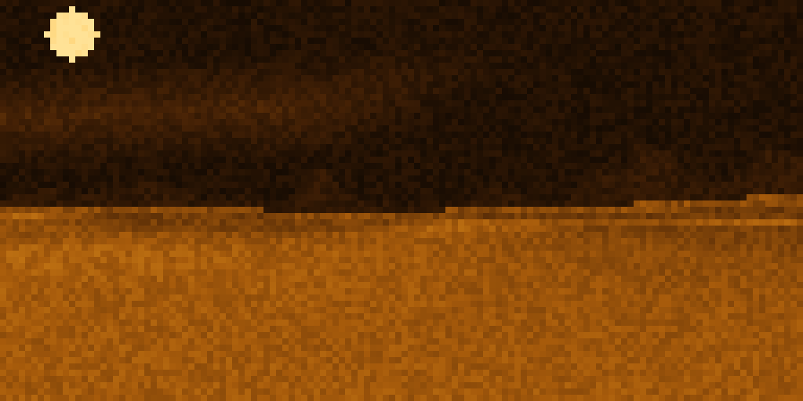
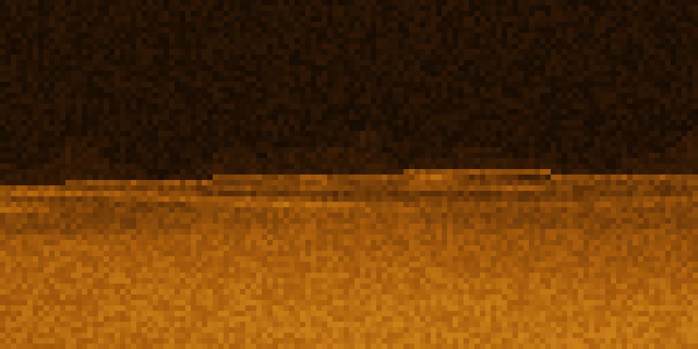
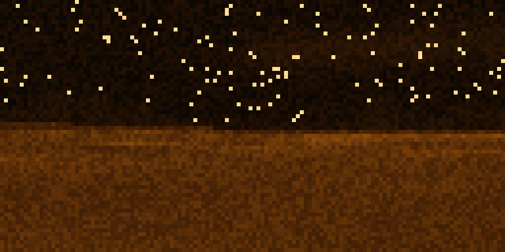

# solaris

> Successive bursts of static came through the headphones, against a
> background of deep, low-pitched murmuring, which seemed to me the very
> voice of the planet itself.
>
> — Stanisław Lem, *Solaris*
